<!-- Profile entry point. Artwork paths stay compatible; generation and verification: SETUP.md.
     Owner: helloe365. Review after a role change, project release or contact change.
     Badge images retain their intrinsic size; percent widths apply to artwork/cards. -->

<picture>
  <source media="(prefers-color-scheme: light)" srcset="./assets/hero-light.svg">
  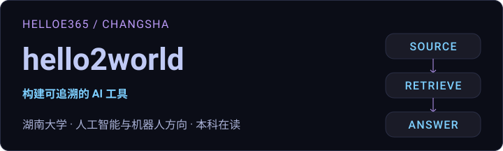
</picture>

我是 **hello2world**，湖南大学**硕士研究生在读**，在长沙探索 AI 应用与数据安全。

  <a href="https://github.com/helloe365/CrackPDFPassword">CrackPDFPassword</a> ·
  <a href="#-featured-projects">全部项目</a> ·
  <a href="#-contact">联系我</a>

   
<picture>
  <source media="(prefers-color-scheme: light)" srcset="./assets/divider-light.svg">
  
</picture>

## 👋 About

<picture>
  <source media="(prefers-color-scheme: light)" srcset="./assets/terminal-light.svg">
  
</picture>

- **身份** — 湖南大学 · 人工智能与机器人方向 · 硕士研究生在读，常驻长沙。
- **方向** — 让回答有来源、实验可复现；从检索问答延伸到数据安全。
- **正在做** — 迭代 [RagAgent](https://github.com/helloe365/RagAgent) 的知识库流程，让文档更新更可靠；完善 [CrackPDFPassword](https://github.com/helloe365/CrackPDFPassword) 的可恢复任务流程，让长任务中断后能继续。
- **交流** — 欢迎讨论检索系统、实验复现与开源工具，联系方式见 [Contact](#-contact)。

<picture>   <source media="(prefers-color-scheme: light)" srcset="https://img.shields.io/badge/RAG-7256a8?style=flat&amp;labelColor=7256a8">    </picture>
<picture>   <source media="(prefers-color-scheme: light)" srcset="https://img.shields.io/badge/Agents-7256a8?style=flat&amp;labelColor=7256a8">    </picture>
<picture>   <source media="(prefers-color-scheme: light)" srcset="https://img.shields.io/badge/Deep%20Learning-7256a8?style=flat&amp;labelColor=7256a8">    </picture>
<picture>   <source media="(prefers-color-scheme: light)" srcset="https://img.shields.io/badge/Data%20Security-7256a8?style=flat&amp;labelColor=7256a8">    </picture>
<picture>   <source media="(prefers-color-scheme: light)" srcset="https://img.shields.io/badge/Reproducibility-7256a8?style=flat&amp;labelColor=7256a8">    </picture>
<picture>   <source media="(prefers-color-scheme: light)" srcset="https://img.shields.io/badge/Local%20Tools-7256a8?style=flat&amp;labelColor=7256a8">    </picture>

   
<picture>
  <source media="(prefers-color-scheme: light)" srcset="./assets/divider-light.svg">
  
</picture>

## 🚀 Featured Projects

  <a href="https://github.com/helloe365/CrackPDFPassword">
<picture>
  <source media="(prefers-color-scheme: light)" srcset="./stats/pin-CrackPDFPassword-light.svg">
  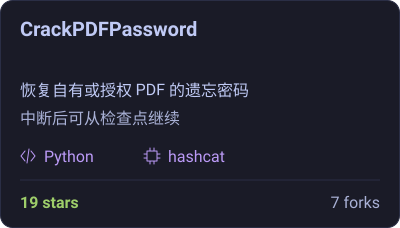
</picture>
  </a>
  <a href="https://github.com/helloe365/CupLens">
<picture>
  <source media="(prefers-color-scheme: light)" srcset="./stats/pin-CupLens-light.svg">
  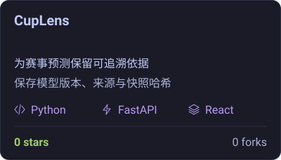
</picture>
  </a>

  <a href="https://github.com/helloe365/RagAgent">
<picture>
  <source media="(prefers-color-scheme: light)" srcset="./stats/pin-RagAgent-light.svg">
  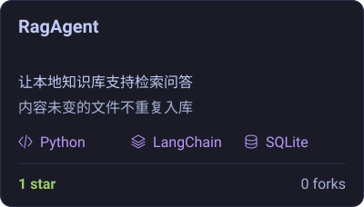
</picture>
  </a>
  <a href="https://github.com/helloe365/AdaptiveFinancialFraudDetectionSystem">
<picture>
  <source media="(prefers-color-scheme: light)" srcset="./stats/pin-AdaptiveFinancialFraudDetectionSystem-light.svg">
  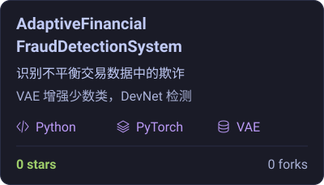
</picture>
  </a>

- [CrackPDFPassword](https://github.com/helloe365/CrackPDFPassword) — 本地 PDF 密码恢复；CPU / GPU 任务支持中断续跑。
- [CupLens](https://github.com/helloe365/CupLens) — 可追溯的赛事预测；保存模型版本、数据来源与快照哈希。
- [RagAgent](https://github.com/helloe365/RagAgent) — 面向本地知识库的检索问答；通过源文件清单实现幂等更新。
- [金融欺诈检测系统](https://github.com/helloe365/AdaptiveFinancialFraudDetectionSystem) — VAE 数据增强与 DevNet 检测，处理类别不平衡问题。

Star / fork 数由 GitHub 仓库 API 每日更新；功能说明可在各项目 README 核查。

   
<picture>
  <source media="(prefers-color-scheme: light)" srcset="./assets/divider-light.svg">
  
</picture>

## 🛠 Tech Stack

<picture>
  <source media="(prefers-color-scheme: light)" srcset="https://skillicons.dev/icons?i=python%2Cpytorch%2Csklearn%2Csqlite%2Clinux%2Cgit%2Cgithub%2Cvscode&amp;perline=11&amp;theme=light">
  
</picture>

<table align="center">
<tr>
<td width="128" align="left">

**Languages**

</td>
<td>

<picture>   <source media="(prefers-color-scheme: light)" srcset="https://img.shields.io/badge/Python-7256a8?style=flat&amp;labelColor=7256a8&amp;logo=python&amp;logoColor=ffffff">    </picture> <picture>   <source media="(prefers-color-scheme: light)" srcset="https://img.shields.io/badge/Markdown-7256a8?style=flat&amp;labelColor=7256a8&amp;logo=markdown&amp;logoColor=ffffff">    </picture>

</td>
</tr>
<tr>
<td width="128" align="left">

**AI · DL**

</td>
<td>

<picture>   <source media="(prefers-color-scheme: light)" srcset="https://img.shields.io/badge/PyTorch-7256a8?style=flat&amp;labelColor=7256a8&amp;logo=pytorch&amp;logoColor=ffffff">    </picture> <picture>   <source media="(prefers-color-scheme: light)" srcset="https://img.shields.io/badge/scikit--learn-7256a8?style=flat&amp;labelColor=7256a8&amp;logo=scikitlearn&amp;logoColor=ffffff">    </picture>

</td>
</tr>
<tr>
<td width="128" align="left">

**LLM · Agent**

</td>
<td>

<picture>   <source media="(prefers-color-scheme: light)" srcset="https://img.shields.io/badge/LangChain-7256a8?style=flat&amp;labelColor=7256a8&amp;logo=langchain&amp;logoColor=ffffff">    </picture> <picture>   <source media="(prefers-color-scheme: light)" srcset="https://img.shields.io/badge/Streamlit-7256a8?style=flat&amp;labelColor=7256a8&amp;logo=streamlit&amp;logoColor=ffffff">    </picture>

</td>
</tr>
<tr>
<td width="128" align="left">

**Data**

</td>
<td>

<picture>   <source media="(prefers-color-scheme: light)" srcset="https://img.shields.io/badge/SQLite-7256a8?style=flat&amp;labelColor=7256a8&amp;logo=sqlite&amp;logoColor=ffffff">    </picture> <picture>   <source media="(prefers-color-scheme: light)" srcset="https://img.shields.io/badge/Pandas-7256a8?style=flat&amp;labelColor=7256a8&amp;logo=pandas&amp;logoColor=ffffff">    </picture>

</td>
</tr>
<tr>
<td width="128" align="left">

**Security**

</td>
<td>

<picture>   <source media="(prefers-color-scheme: light)" srcset="https://img.shields.io/badge/hashcat-7256a8?style=flat&amp;labelColor=7256a8">    </picture> <picture>   <source media="(prefers-color-scheme: light)" srcset="https://img.shields.io/badge/Data%20Privacy-7256a8?style=flat&amp;labelColor=7256a8">    </picture>

</td>
</tr>
<tr>
<td width="128" align="left">

**OS · Tools**

</td>
<td>

<picture>   <source media="(prefers-color-scheme: light)" srcset="https://img.shields.io/badge/Linux-7256a8?style=flat&amp;labelColor=7256a8&amp;logo=linux&amp;logoColor=ffffff">    </picture> <picture>   <source media="(prefers-color-scheme: light)" srcset="https://img.shields.io/badge/Git-7256a8?style=flat&amp;labelColor=7256a8&amp;logo=git&amp;logoColor=ffffff">    </picture>

</td>
</tr>
</table>

   
<picture>
  <source media="(prefers-color-scheme: light)" srcset="./assets/divider-light.svg">
  
</picture>

## 📊 GitHub Stats

<picture>
  <source media="(prefers-color-scheme: light)" srcset="./stats/stats-light.svg">
  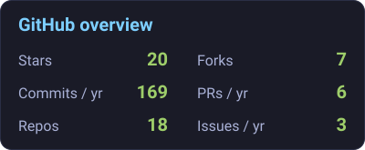
</picture>
<picture>
  <source media="(prefers-color-scheme: light)" srcset="./stats/top-langs-light.svg">
  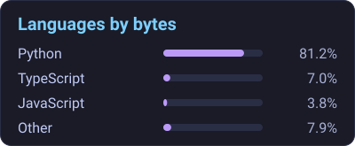
</picture>

仓库指标来自 GitHub API；提交、PR、issue 为最近一年贡献。语言按代码字节计，不代表熟练度。[查看数据快照](./stats/data.json)。

<picture>
  <source media="(prefers-color-scheme: light)" srcset="./assets/contributions-toggle-light.svg">
  
</picture>

### Contribution City

<picture>
  <source media="(prefers-color-scheme: light)" srcset="./profile-3d-contrib/profile-season-animate.svg">
  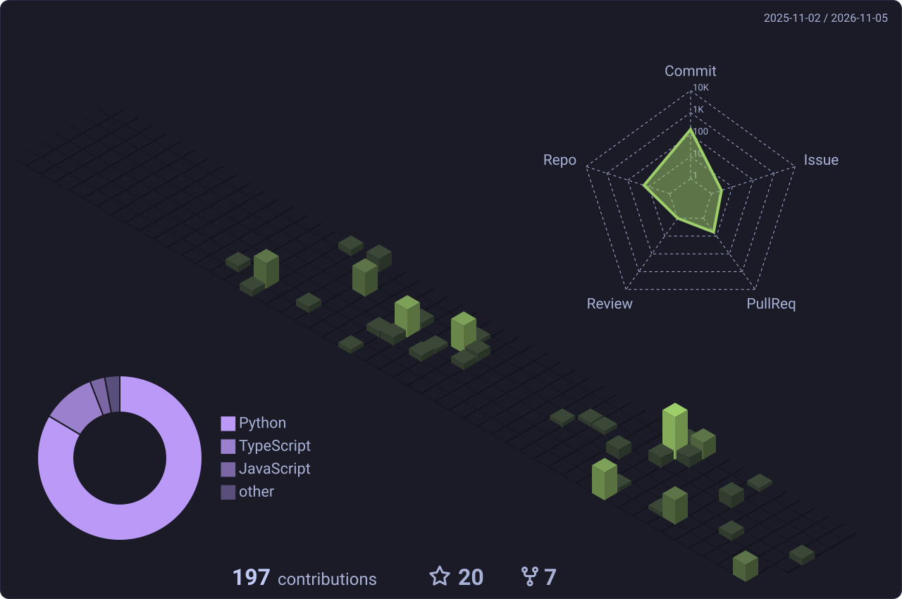
</picture>

GitHub 最近一年可见贡献；方块高度表示当天贡献数，包含提交、PR、issue 等活动。

### Weekly Activity

<picture>
  <source media="(prefers-color-scheme: light)" srcset="./stats/activity-light.svg">
  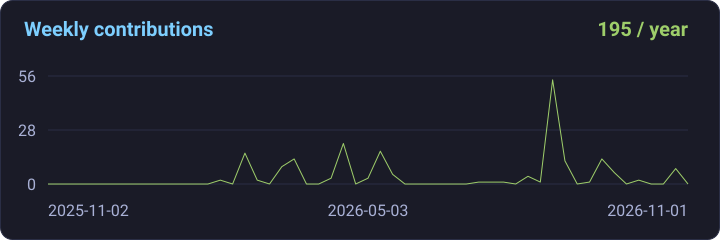
</picture>

按 GitHub 日历周汇总贡献，首尾周可能不完整；贡献数不等于提交数。

### Milestones

<picture>
  <source media="(prefers-color-scheme: light)" srcset="./stats/trophies-light.svg">
  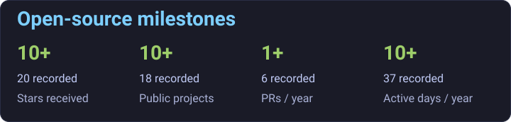
</picture>

按实际计数展示 1 / 10 / 100 等本地阈值；这是个人里程碑，不是 GitHub 官方成就或能力评级。

### Contribution Snake

<picture>
  <source media="(prefers-color-scheme: light)" srcset="https://raw.githubusercontent.com/helloe365/helloe365/output/github-contribution-grid-snake.svg">
  <source media="(prefers-color-scheme: dark)" srcset="https://raw.githubusercontent.com/helloe365/helloe365/output/github-contribution-grid-snake-dark.svg">
  
</picture>

同一份贡献日历的动画展示；SVG 保存在本仓库 output 分支。

以上图表由本仓库 GitHub Actions 每日生成，也支持手动运行。[更新流程与数据口径](./SETUP.md)。

   
<picture>
  <source media="(prefers-color-scheme: light)" srcset="./assets/divider-light.svg">
  
</picture>

## 📫 Contact

  <a href="mailto:helloe2718@gmail.com"><picture>   <source media="(prefers-color-scheme: light)" srcset="https://img.shields.io/badge/Email-217594?style=flat&amp;labelColor=217594&amp;logo=gmail&amp;logoColor=ffffff">    </picture></a>
  <a href="https://github.com/helloe365"><picture>   <source media="(prefers-color-scheme: light)" srcset="https://img.shields.io/badge/GitHub%20%C2%B7%20helloe365-217594?style=flat&amp;labelColor=217594&amp;logo=github&amp;logoColor=ffffff">    </picture></a>

  <a href="mailto:helloe2718@gmail.com">helloe2718@gmail.com</a> ·
  <a href="https://github.com/helloe365">@helloe365</a>

<picture>
  <source media="(prefers-color-scheme: light)" srcset="./assets/footer-light.svg">
  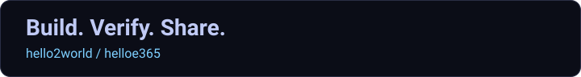
</picture>

<a href="https://github.com/helloe365">返回个人主页</a>

